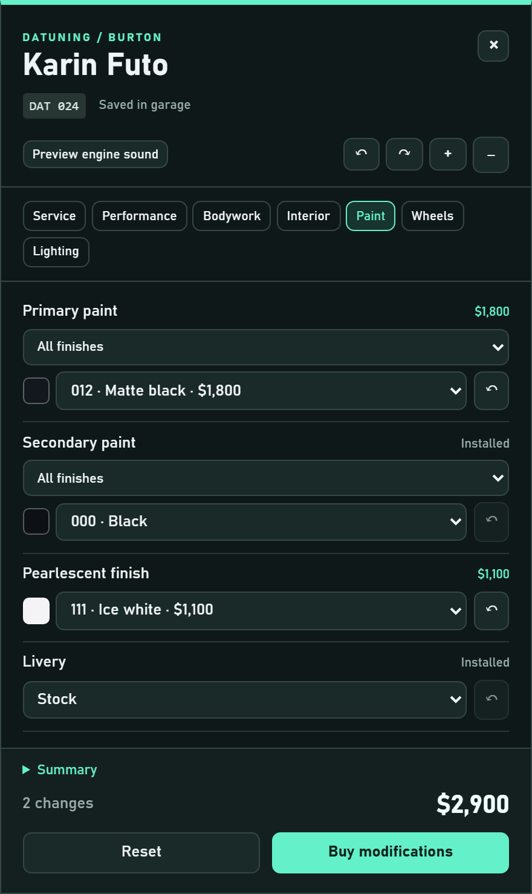
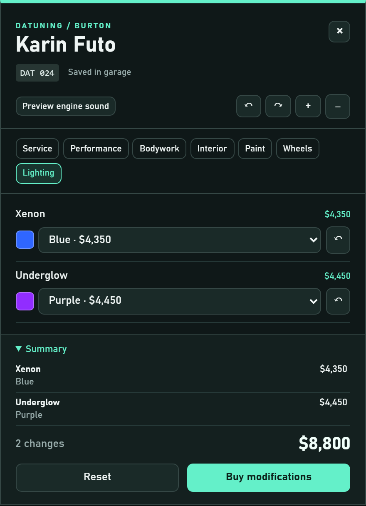

# DaTuning

DaTuning is a job-restricted FiveM tuning workshop for **ESX** and **QBCore**. Mechanics can customize customer vehicles, preview changes in real time, and pay for the finished job from their company account.

## Workshop preview

| Paint and finish filters | Lighting and purchase summary |
| --- | --- |
|  |  |

*Screenshots of the DaTuning interface with sample data. FiveM renders the vehicle preview in-game.*

## Installation

1. Place the `DaTuning` folder in your FiveM resources directory.
2. Enable **OneSync** and start **oxmysql** and the resources for your framework before DaTuning.
3. Add `ensure DaTuning` to your `server.cfg`. If you add the resource while the server is running, run `refresh` followed by `ensure DaTuning` in the server console.

| Framework | Required resources and database tables |
| --- | --- |
| **ESX** | `es_extended`, `esx_addonaccount`, and the `owned_vehicles` table. Set up the shared account for the mechanic job in ESX. |
| **QBCore** | `qb-core`, `qb-banking`, and the `player_vehicles` table. Set up the mechanic job account in `qb-banking`. |

DaTuning uses the existing vehicle and account tables. Standard ESX and QBCore setups require no additional DaTuning SQL file.

## Configuration

Edit the settings in [config.lua](config.lua).

| Setting | Default and purpose |
| --- | --- |
| `Framework` | `'auto'` detects ESX or QBCore. Set `'esx'` or `'qbcore'` to select one explicitly. |
| `Locale` | `'de'` for German by default. Set `'en'` for English. Vehicle and part names supplied by GTA follow the player's game language. |
| `Jobs` | `{ mechanic = true }`. Add other job names to grant access. |
| `SocietyAccounts` | ESX uses `society_<job>` by default, such as `society_mechanic`. This setting overrides account names by job. |
| `QBSocietyAccounts` | QBCore uses the job name as the account name by default, such as `mechanic`. This setting overrides account names by job. |
| `Shops` | Workshops in Burton, La Mesa, Blaine County, and Paleto Bay. Edit the coordinates to move or add locations. |
| `PreviewDistance` | `45.0` in-game meters. Players within this distance and in the same routing bucket can see the preview and hear horn and engine sound tests. |
| `Command` | `'tuning'`, the command players use to open the workshop. |

Prices and upgrade increments are configurable per part. Run `restart DaTuning` to reload configuration changes.

## Using the workshop

1. With an approved job, drive to a workshop marker, stop, and remain in the driver's seat.
2. Press **E** or enter **`/tuning`** in chat.
3. Select your modifications. Drag across the preview or use **A / D**, the arrow keys, or the on-screen camera controls to orbit the vehicle.
4. Open **Summary** to review the individual prices, then choose **Buy modifications**. Click **↶** to reset one option to its original value or **Reset** to discard all pending changes.

The workshop covers repairs, performance, bodywork, interior, paint, liveries, wheels, tires, xenon, and underglow. **Preview horn** plays the selected horn. **Preview engine sound** briefly revs the preview vehicle.

### Payment and persistence

The server checks job access and calculates the total at checkout. If the company account has insufficient funds, the selection stays open. If a database write fails after payment, DaTuning refunds the company account.

DaTuning saves modifications permanently when the vehicle has a matching garage record, including customer vehicles owned by another player. For vehicles without a garage record, modifications last for the lifetime of the current vehicle.

## Commands

| Command | Purpose |
| --- | --- |
| `/tuning` | Opens the workshop at a marker for an approved driver in a supported vehicle. |
| `/addsocietymoney mechanic 50000` | Admin command that credits 50,000 to the `mechanic` company account. The job must be allowed in DaTuning. |
| `addsocietymoney mechanic 50000` | The same command in the server console, without the leading slash. |

## Troubleshooting

**Turbo or another part reverts.** Check whether a second tuning resource such as `esx_lscustom` serves the same location. Both resources can modify the same vehicle.

**Rear underglow only appears after a repair.** Vehicle damage can affect how GTA renders the lighting. Use **Service → Repair vehicle** to preview the repair before buying it.

**The company account cannot be found.** Check the allowed job name and account mapping in the config. ESX requires an existing shared account in `esx_addonaccount`. QBCore requires an existing job account in `qb-banking`.